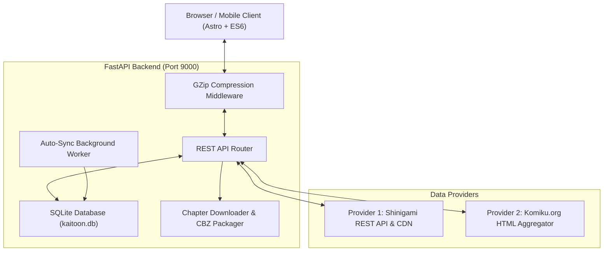

# Kaitoon (怪盗)

<p align="center">
  
</p>

<h3 align="center">Modern, Ad-Free, Multi-Provider Web Comic Reader & Downloader</h3>

<p align="center">
  Nikmati pengalaman membaca Manga, Manhwa, dan Manhua tanpa iklan, bersih, cepat, dan dioptimalkan untuk layar OLED.
</p>

<p align="center">
  <a href="https://github.com/kaivyy/kaitoon/actions"></a>
  <a href="https://fastapi.tiangolo.com/"></a>
  <a href="https://astro.build/"></a>
  <a href="https://www.python.org/"></a>
  <a href="https://sqlite.org/"></a>
  <a href="./LICENSE"></a>
</p>

---

## 🌟 Tentang Kaitoon

**Kaitoon** adalah aplikasi web reader komik digital mandiri (*self-hosted*) yang dirancang khusus untuk pembaca manga, manhwa, dan manhua yang mendambakan antarmuka minimalis, elegan, dan 100% bebas dari segala bentuk iklan atau pelacak.

Dibangun dengan arsitektur terpadu antara **FastAPI (Python 3.13)** di sisi backend dan **Astro 5 + Vanilla ES6** di sisi frontend, Kaitoon menghadirkan performa secepat kilat dengan konsumsi memori minimal serta dukungan multi-server (Shinigami dan Komiku).

---

## ✨ Fitur Utama

### 🌙 Tampilan OLED Pure Black
- Dirancang khusus dengan palet warna hitam murni (`#000000`) dan aksen emerald (`#10b981`).
- Memaksimalkan efisiensi baterai pada layar AMOLED/OLED sekaligus nyaman di mata saat membaca dalam kondisi minim cahaya.
- Memenuhi standar rasio kontras tinggi WCAG AAA.

### 🚫 Bebas Iklan & Bersih dari Distraksi
- Tidak ada popup, banner promosi, redirect, captcha, maupun skrip pelacak pihak ketiga.
- Kontrol navigasi otomatis menyembunyikan diri saat Anda menggulir halaman, menyisakan seluruh layar hanya untuk lembar komik Anda.

### 🔄 Multi-Provider Server Aggregator
- **Server 1 (Shinigami)**: Menghubungkan langsung ke REST API Shinigami dengan auto-resolving domain mirror aktif (`shinigami.to` ke domain CDN aktif) dan rekonstruksi gambar terdistribusi.
- **Server 2 (Komiku.org)**: Integrasi perayap multi-halaman berkecepatan tinggi dengan sistem *permanent SQLite caching*, memungkinkan penjelajahan katalog instan tanpa latensi berulang.
- Pemilih server dinamis di bagian bawah layar yang memudahkan pergantian sumber kapan saja.

### 📖 Dual-Mode Reader & Auto-Scroll Pintar
- **Webtoon Mode**: Gulir vertikal mulus (*continuous scroll*) tanpa jeda antar-gambar.
- **Smart Auto-Scroll**: Fitur gulir otomatis hands-free dengan kontrol kecepatan dinamis (0.5x hingga 5.0x), tombol pause/play instan di floating dock, serta modal pengaturan kecepatan presisi.
- **Manga Slide Mode**: Membaca per lembar dengan pembagian zona sentuh (kiri 35% untuk halaman sebelumnya, kanan 35% untuk halaman berikutnya, tengah 30% untuk toggle kontrol) dan navigasi tombol keyboard (panah kiri/kanan).

### 🏷️ Pelacak Progres & Penanda Episode (Read/Unread)
- **Indikator Visual Menyeluruh**:
  - Penanda **Sudah Dibaca** dengan ikon centang hijau emerald.
  - Penanda **Belum Dibaca** dengan titik status biru.
  - Penanda **Terakhir Dibaca** pada chapter riwayat aktif.
  - Penanda **Sedang Dibaca** di dalam drawer chapter reader.
- **Ringkasan Progres di Detail Komik**: Tampilan metrik langsung (contoh: *Progres: 14 dari 80 episode dibaca*).
- **Aksi Cepat**: Tombol *Tandai Semua Dibaca* untuk menandai seluruh episode dalam 1 klik, serta tombol toggle centang di setiap baris episode.
- **Sinkronisasi Dua Arah**: Disimpan instan di `localStorage` peramban dan dicadangkan ke basis data SQLite server untuk sinkronisasi multi-perangkat.

### 🔗 URL Ramah Pengguna & Tanpa Refresh
- URL bersih berbasis slug (contoh: `#manga/solo-leveling/chapter-1`).
- Posisi membaca dan rute halaman tersimpan secara persisten saat Anda menyegarkan halaman (*refresh*) atau beralih aplikasi di ponsel.
- *Route Preloader* sinkron yang menghilangkan efek kedipan layar (*screen flash*).

### 📦 Pengunduh & Pembuat Arsip CBZ Digital
- Pengunduhan gambar multi-utas (*multithreaded*) dengan mekanisme *exponential backoff retry*.
- Otomatis mengemas lembaran gambar menjadi arsip komik digital standar `.cbz` (Comic Book Zip) siap baca untuk aplikasi offline e-reader.

### ⚡ Kompresi Gzip & Efisiensi Bandwidth
- Middleware Gzip otomatis aktif untuk semua tanggapan REST API dan aset statis, memangkas penggunaan kuota hingga 80%.

---

## 🏗️ Arsitektur Sistem



---

## 🛠️ Tech Stack

| Komponen | Teknologi | Keterangan |
| :--- | :--- | :--- |
| **Backend** | Python 3.13, FastAPI, Uvicorn | REST API asinkron, performa tinggi |
| **Frontend** | Astro 5, Vanilla ES6, CSS Murni | Zero JavaScript framework overhead, pure OLED UI |
| **Basis Data** | SQLite 3 | Riwayat baca, watchlist favorit, status unduhan |
| **Kompresi** | GZip Middleware, Zipfile | Pengurangan ukuran transfer data & arsip CBZ |
| **Proses Daemon** | PM2 Ecosystem | Manajemen proses latar belakang produksi |
| **Pengujian** | Pytest, HTTPX TestClient | 48 pengujian unit, integrasi, dan delivery gate |

---

## 🚀 Memulai (Quick Start)

### 1. Prasyarat
- **Python 3.11** atau versi lebih baru
- **Node.js 20+** dan **pnpm** (opsional, jika ingin mengompilasi frontend Astro sendiri)

### 2. Klon Repositori
```bash
git clone https://github.com/kaivyy/kaitoon.git
cd kaitoon
```

### 3. Pasang Dependensi Python
```bash
pip install fastapi uvicorn httpx pydantic
```

### 4. Kompilasi Frontend (Opsional)
Jika Anda melakukan perubahan pada folder `frontend/`:
```bash
cd frontend
pnpm install
pnpm run build
cd ..
```
*Catatan: File hasil kompilasi statis sudah tersedia secara bawaan di folder `static/`.*

### 5. Jalankan Server
Jalankan server Kaitoon di port default `9000`:
```bash
python3 server.py
```
Atau tentukan port dan host kustom:
```bash
python3 server.py --host 0.0.0.0 --port 9000
```

Buka peramban favorit Anda dan kunjungi:
```
http://localhost:9000
```

---

## ⚙️ Menjalankan dengan PM2 (Produksi)

Kaitoon menyediakan konfigurasi PM2 bawaan (`ecosystem.config.cjs`) untuk manajemen proses latar belakang yang tahan gangguan:

```bash
# Menjalankan backend dan frontend
pm2 start ecosystem.config.cjs

# Memeriksa status proses
pm2 status

# Melihat log langsung
pm2 logs kaitoon-backend
pm2 logs kaitoon-frontend

# Restart layanan
pm2 restart ecosystem.config.cjs
```

---

## 💻 Penggunaan Melalui Terminal (CLI)

Kaitoon dilengkapi antarmuka baris perintah (`cli.py`) yang lengkap:

```bash
# 1. Menampilkan komik terbaru
python3 cli.py latest --limit 10

# 2. Mencari judul komik
python3 cli.py search "Solo Leveling"
python3 cli.py search "Magic Emperor"

# 3. Melihat detail dan sinopsis
python3 cli.py detail <manga_id>

# 4. Melihat daftar episode/chapter
python3 cli.py chapters <manga_id> --page 1 --limit 30 --order desc

# 5. Mengambil URL gambar dalam chapter
python3 cli.py pages <chapter_id>

# 6. Mengunduh chapter ke format .cbz
python3 cli.py download <chapter_id> --output ./downloads --workers 5

# 7. Mengekspor metadata komik ke file JSON
python3 cli.py export <manga_id> --output manga_data.json
```

---

## 🔌 Dokumentasi REST API

| Metode | Endpoint | Deskripsi |
| :--- | :--- | :--- |
| `GET` | `/` | Melayani halaman utama web reader |
| `GET` | `/api/latest?page=1&server=shinigami` | Mengambil daftar komik rilisan terbaru |
| `GET` | `/api/search?q=solo&server=shinigami` | Mencari judul komik berdasarkan kata kunci |
| `GET` | `/api/manga/{id}?server=shinigami` | Mengambil informasi detail, sinopsis, dan daftar chapter |
| `GET` | `/api/chapter/{id}/pages` | Mengambil daftar URL gambar resolusi tinggi |
| `POST` | `/api/history` | Menyimpan riwayat dan progres membaca terakhir |
| `GET` | `/api/history` | Mengambil riwayat komik yang telah dibaca |
| `GET` | `/api/history/{id}/chapters` | Mengambil daftar chapter yang sudah dibaca untuk komik tertentu |
| `POST` | `/api/history/mark-read` | Menandai atau membatalkan status baca untuk satu chapter |
| `POST` | `/api/history/mark-all-read` | Menandai daftar chapter sekaligus sebagai sudah dibaca |
| `POST` | `/api/watchlist/toggle` | Menambahkan atau menghapus komik dari daftar favorit |
| `GET` | `/api/watchlist` | Mengambil daftar komik favorit |
| `POST` | `/api/chapter/{id}/download` | Mengunduh chapter di server dan mengemasnya ke file `.cbz` |
| `GET` | `/api/downloads` | Melihat status tugas pengunduhan yang sedang berjalan |

---

## 🧪 Pengujian Otomatis

Kaitoon dilengkapi 48 uji kasus otomatis mencakup seluruh alur sistem:
- **`test_db.py`**: Validasi operasi CRUD SQLite, riwayat baca, watchlist, dan tracking episode.
- **`test_downloader.py`**: Validasi sanitasi nama berkas, pembuatan arsip CBZ, dan pembersihan folder sementara.
- **`test_server.py`**: Validasi seluruh endpoint REST API, fallback provider, dan tugas sinkronisasi latar belakang.
- **`test_frontend.py`**: Validasi keberadaan aset statis, kepatuhan struktur HTML semantic, dan aturan kontras warna.
- **`test_e2e.py`**: Validasi alur integrasi menyeluruh dan pengujian antislop delivery gate (R-02, R-03, R-21, R-25, R-26, R-27, R-32, R-35).

Jalankan pengujian dengan perintah:
```bash
pytest tests/ -v
```

---

## 📜 Lisensi

Proyek ini dilisensikan di bawah naungan **[MIT License](./LICENSE)**. Silakan digunakan, dimodifikasi, dan didistribusikan untuk keperluan pribadi maupun komunitas.

Dibuat dengan dedikasi untuk komunitas pembaca komik Indonesia oleh **[Kaivy](https://github.com/kaivyy)**.
